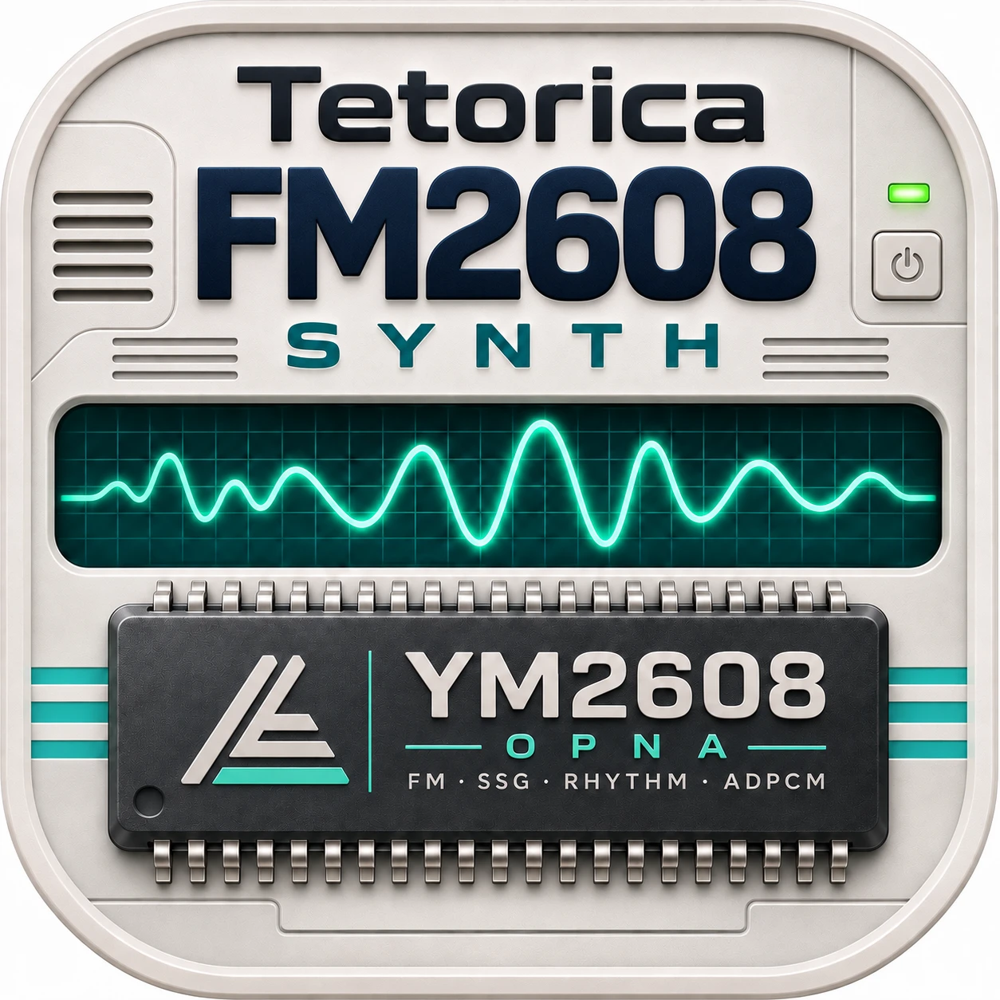

# Tetorica FM2608 Synth — Desktop



Explore the YM2608 / OPNA used by PC-98 sound hardware in a Tauri desktop app.
The application includes the readable Tetorica Web Synth and the Menu, Pin,
native file saving and audio-output controls used by the other desktop Synths.

The initial app version is **0.0.1**. The imported Web release and each of its
files are pinned by SHA-256 in [release.lock.json](release.lock.json).

## Sound and editing

- Six FM channels, three SSG channels, six fixed Rhythm voices and one ADPCM-B
  sample voice, with sound-section tabs and physical-channel editing.
- FM operators, hardware LFO, CH3 special frequencies, operator Key On and CSM.
- SSG Tone / Noise, shared Noise period and shared hardware Envelope.
- ADPCM audio import, whole-sample Repeat, tuning, wave drawing and WAV export.
- Keyboard, Octave, Pitch, Master up to 380% and the output monitor.
- Files presets and editable JavaScript with Monaco, Run / Apply / Stop.
- VGM / VGZ / S98 reference playback, automatic YM2203 compatibility, Live
  controls, paused audition, Capture and per-channel Mixer controls.
- Song import saves the original in `/vgm/` and extracted instruments in
  `/presets/<song>/`. Choose a saved instrument to load its sound section.

The Rhythm section uses Tetorica's original synthetic rhythm ROM. Imports
retain recorded static instrument settings. Later software automation stays
with the song, and incomplete sample ranges report their capture limits.
See the [included Synth guide](dist/synth-fm2608/README.md) for the full controls.
Looper and Event recording remain deferred.

## Desktop controls

The top-left **Menu** contains import / export, project operations, audio output
and reload. **Pin** keeps the window on top. Reload asks before clearing edits.

**Web Audio** is the default. **Native (Rust)** routes the final stereo Master
output from the same WASM / AudioWorklet renderer to a CPAL output device.
Keyboard, Code and song playback share this output. The waveform monitor stays
connected to the same final bus.

Changing output or device stops playback, releases held notes and resets Pitch,
while preserving the selected song and editable instrument. Background WebView
behavior and physical-device listening remain part of manual verification.

## Run and build

Install Node.js, Python 3, Rust and the platform's Tauri prerequisites.
From this repository, run the following commands.

```sh
npm ci
python3 scripts/import_release.py --check
npm test
npm run test:native
npm run dev
```

On Windows, use `python` if `python3` is unavailable.
To create a local macOS app without distribution signing, run the following.

```sh
npm run build -- --bundles app --no-sign -- --locked
```

The app is created at
`src-tauri/target/release/bundle/macos/Tetorica FM2608 Synth.app`.
For signed Intel and Apple Silicon app / DMG builds, set your local
`APPLE_PASSWORD` and run `sh deploy_mac.sh`. The script follows the existing
Tetorica local signing configuration. Keep credentials in your environment.

## Import a Web release and set the app version

```sh
npm run import:release -- /path/to/tetorica_fm2608_synth_WEB_VERSION_itch.zip --version X.Y.Z
python3 scripts/import_release.py --check
```

Replace `X.Y.Z` with the app's numeric three-part version. The Web ZIP name and
version remain independent. The optional `--version` updates `package.json`,
`package-lock.json`, `src-tauri/Cargo.toml`, the app entry in `Cargo.lock` and
`src-tauri/tauri.conf.json` together, retaining the dependency versions.

Build after importing, then include updated metadata, lock files, `dist/` and
`release.lock.json` in the release commit before creating a tag. Importing a
ZIP performs the local asset and metadata update.

## Inspect and modify

Application modules retain their original formatting, comments and names.
The importer verifies the readable browser source archive, module graph,
matching native rebuild inputs, WASM receipts, rhythm generator and licenses.

| Location | Contents |
| --- | --- |
| [dist/synth-fm2608](dist/synth-fm2608/) | Synth UI, Code host, song playback and preset extraction |
| [dist/js](dist/js/) | Reusable JavaScript chip APIs and runtime |
| [dist/generated](dist/generated/) | Matching YM2608 WASM |
| [dist/sources](dist/sources/) | Browser originals, native sources, build recipes and receipts |
| [desktop](desktop/) | Desktop Menu, file saving and audio-output adapters |
| [src-tauri/src](src-tauri/src/) | Tauri host and CPAL device output |

Desktop adapters are appended by the local resource server. The imported
`dist/` files retain their original bytes. After editing those files, record
the changes before building.

```sh
npm run record:edits
python3 scripts/import_release.py --check
```

`local-changes.json` records edits over the pinned release. Re-importing a ZIP
replaces `dist/`, so keep edits in Git and reapply them when updating. The
`.gitattributes` file preserves imported bytes on every checkout platform.

## Verification and CI

```sh
npm test
npm run test:browser -- --out artifacts/desktop-browser.json --screenshots artifacts/screenshots
npm run test:audio-transport -- artifacts/audio-transport.json
npm run test:native
cargo fmt --manifest-path src-tauri/Cargo.toml --check
```

Browser checks use real OPNA WASM / AudioWorklet audio with a mocked desktop
host and muted speakers. Rust tests exercise device-output logic without
opening a physical audio device.

[Build Desktop](.github/workflows/build-desktop.yml) configures macOS Apple
Silicon / Intel, Windows x64 and Linux x64 / ARM64 builds. Main-branch builds
produce workflow artifacts. Tags beginning with `v` attach installers to a
draft GitHub release. CI installers are unsigned. Local `deploy_mac.sh` uses
the Mac's signing identity and exported notarization password.

Current work and verification are tracked in
[the TODO](docs/todo_20261115.md) and [verification notes](docs/verification_20261115.md).

## Sources and licenses

The desktop wrapper uses the [BSD 3-Clause license](LICENSE). Imported files
retain their original licenses. The package includes ymfm source and notices,
the native YM2608 wrapper and the synthetic rhythm generator.

- [Tetorica goals, sound-chip APIs and source](https://github.com/kyorohiro/hello_ymfm_wasm)
- [FM2608 Web Synth](https://kyorohiro.github.io/hello_ymfm_wasm/synth-fm2608/index.html)
- [Native sound-chip SDK](https://github.com/kyorohiro/tetorica-soundchip-native)
- [YM2608 build sources](dist/sources/YM2608.md)

## 日本語

PC-98のYM2608 / OPNAを触るTauri版です。FM・SSG・Rhythm・ADPCM、Code、
VGM / VGZ / S98の試聴・Live表示・音色取り込みに対応します。YM2203の曲も
自動判別して互換再生します。Web版の可読ソースと再ビルド用ソースを含みます。

MenuとPinは他のTetorica版に合わせています。初期状態はWeb Audioです。
Native出力では、同じ最終音声をRustから出力デバイスへ送ります。
ローカル署名付きのIntel / Apple Siliconビルドには`sh deploy_mac.sh`を使います。
確認結果と残りの手動確認は、上記のTODO・検証記録を参照してください。
